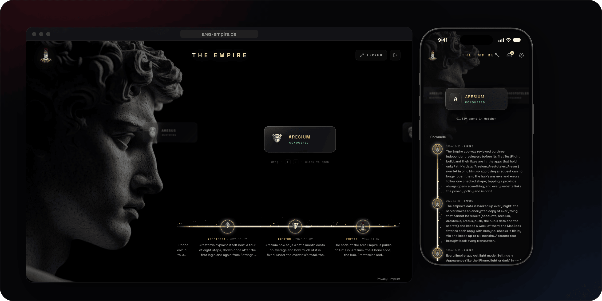
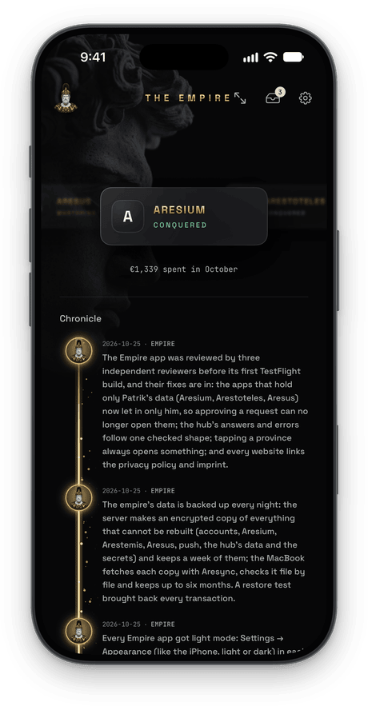
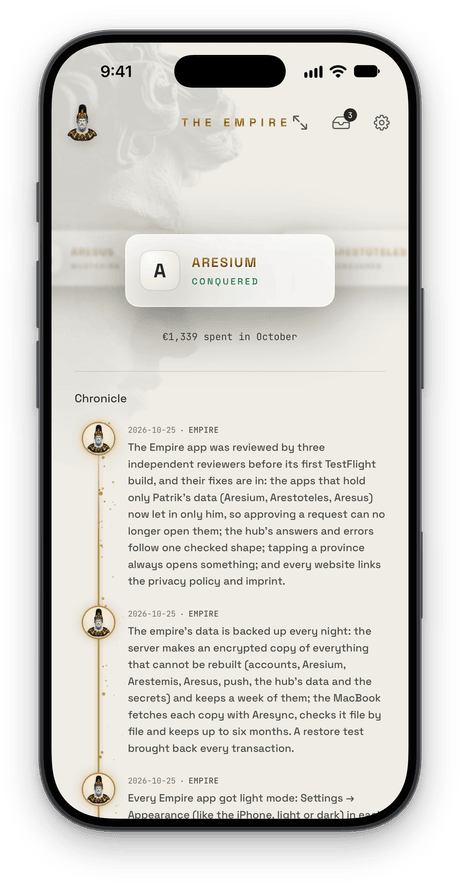
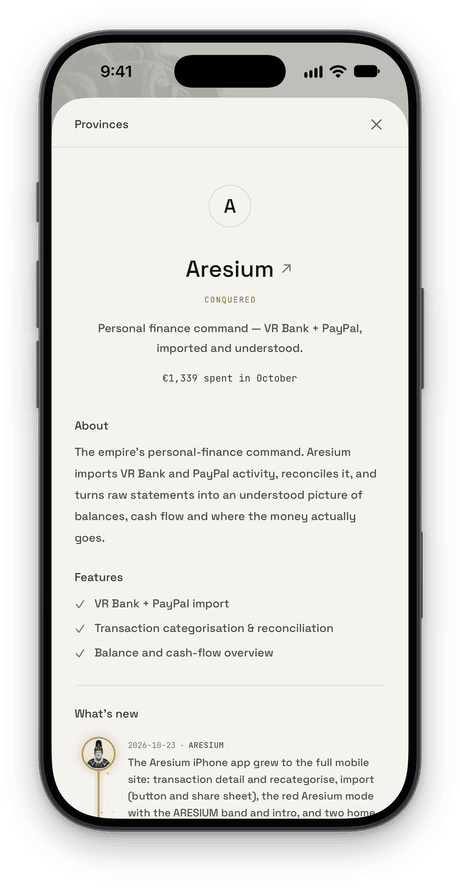
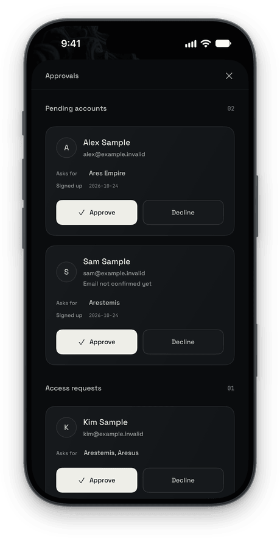
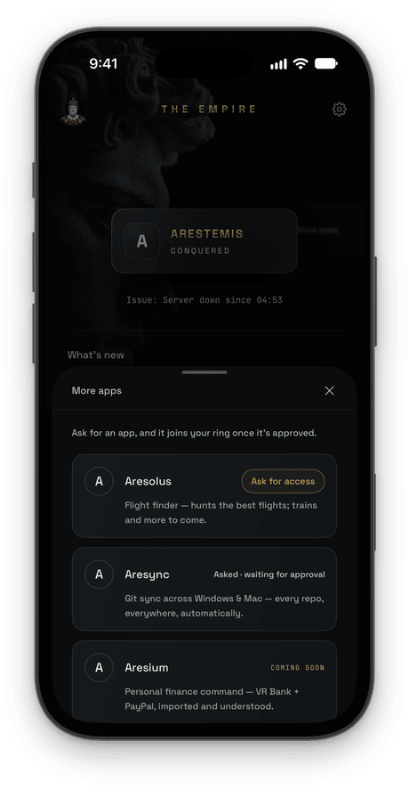

<p align="center">
  
</p>

# Ares Empire

The hub of the Ares apps: one account for all of them, the push service behind their notifications, and the overview
at **[ares-empire.de](https://www.ares-empire.de)** (behind a login; a **[demo](https://www.ares-empire.de/demo)** on
made-up data for anyone): every app on a ring, with the chronicle of what was built.

[The apps](https://patrikbreeck.com/en/apps/) · [Their iPhone code](https://github.com/Ares-Empire/empire-ios) ·
[The project map](EMPIRE.md)

## What lives here

| Part | What it is |
|---|---|
| **The hub website** (`web/`) | The apps on a ring that turns, a board for each, the chronicle as a timeline, and the plans. A phone version too. No build step: React and Babel are served from the repository itself. |
| **Accounts** (`accounts/`) | One account for every app, on PocketBase: sign-up, email confirmation, approval, password reset, and access per app. [docs/ACCOUNTS.md](docs/ACCOUNTS.md) |
| **The web server** (`webauth/`) | The login gate, the hub's API, and the legal and contact pages in English and German. Python's standard library only. |
| **Push** (`push/`) | One service that sends the notifications of the Arestemis, Aresus and Ares Empire iPhone apps through Apple's push service. [docs/PUSH.md](docs/PUSH.md) |
| **Backups** (`backup/`) | The nightly encrypted backup of the data that cannot be rebuilt. [docs/BACKUP.md](docs/BACKUP.md) |
| **The map** ([`EMPIRE.md`](EMPIRE.md)) | The projects, the shared design language, how the apps are built, and the chronicle. |

## The apps

| App | What it is | Code |
|---|---|---|
| **Aresium** | Personal finance from bank exports | [aresium](https://github.com/Ares-Empire/aresium) |
| **Arestemis** | Searches that run for you: flats, things for sale, prices, pages ([demo](https://arestemis.de)) | iPhone app in [empire-ios](https://github.com/Ares-Empire/empire-ios) |
| **Arestoteles** | A personal knowledge map, searched by meaning | [Arestoteles](https://github.com/Ares-Empire/Arestoteles) |
| **Aresus** | The watchtower over the server, the services and the machines' sync; files from the iPhone to the Mac | iPhone app in [empire-ios](https://github.com/Ares-Empire/empire-ios) |
| **Ares Empire** | This hub, and its iPhone app | here, and [empire-ios](https://github.com/Ares-Empire/empire-ios) |

## Screenshots

<table>
  <tr>
    <td></td>
    <td></td>
    <td></td>
    <td></td>
    <td></td>
  </tr>
</table>

## Design language

Near-black walls, glass cards and faint red and blue light; polished gold only as an accent; Space Grotesk and
JetBrains Mono. Each app has a marble bust of its own and one accent colour. The details are in
[EMPIRE.md](EMPIRE.md) → The crown language.

## Run it locally

```sh
python3 -m http.server 8099 --directory web               # the hub on its bundled data: http://127.0.0.1:8099
# In a shell with age and age-keygen installed, and PocketBase 0.40.6 available:
python3 -m venv .venv
. .venv/bin/activate
python3 -m pip install -r push/requirements.txt requests
python3 -m unittest discover -s webauth -p 'test_*.py'
python3 -m unittest test_empire_http push.test_push backup.test_backup tools.test_empire_samples tools.test_empire_sync
node --test accounts/test_jobs.js
POCKETBASE=/path/to/pocketbase bash accounts/test-rules.sh
```

The full server (login, legal pages) and deploying: [docs/DEVELOPMENT.md](docs/DEVELOPMENT.md).

## Tests and CI

GitHub Actions runs all commands in “Run it locally” on every push, pull request and manual start. It installs
`age` and `age-keygen` (both required, so archive tests cannot silently skip), Python packages and PocketBase
0.40.6. The Linux amd64 release is checked against its pinned SHA-256 before use. Tests use invented data and
local fakes; no accounts, push keys, owner file or server configuration are needed.

CI uses the server's Python 3.13 (3.13.5 on 2026-11-07) and Node 24. Local tests use a venv, as above.

## License

Free to use, change and share for non-commercial purposes, such as study, research, hobby projects, schools and
charities, under the [PolyForm Noncommercial License 1.0.0](LICENSE.md). Commercial use, also inside a company, needs
permission: [ares-empire.de/contact](https://www.ares-empire.de/contact).

The licence covers the code. It does not cover the Ares names, the busts, the app icons or the screenshots. Parts from
others keep their own licences:

- `web/vendor/` ([sources and versions](web/vendor/README.md)): React and React DOM (MIT,
  [LICENSE-react.txt](web/vendor/LICENSE-react.txt)), Babel (MIT, [LICENSE-babel.txt](web/vendor/LICENSE-babel.txt))
  and Lucide (ISC, [LICENSE-lucide.txt](web/vendor/LICENSE-lucide.txt)).
- `web/fonts/`: Space Grotesk, JetBrains Mono and Cinzel, under the SIL Open Font License 1.1
  ([Space Grotesk](web/fonts/OFL-SpaceGrotesk.txt), [JetBrains Mono](web/fonts/OFL-JetBrainsMono.txt),
  [Cinzel](web/fonts/OFL-Cinzel.txt)).
